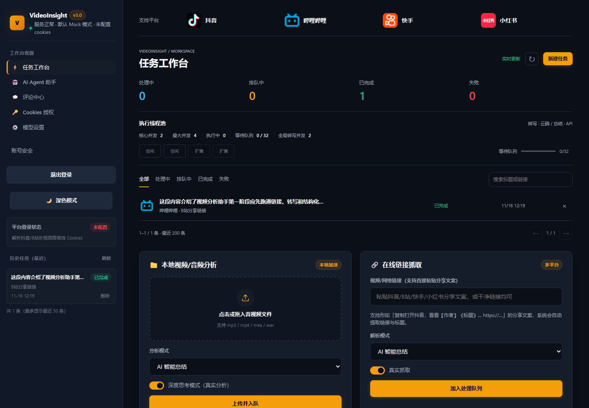
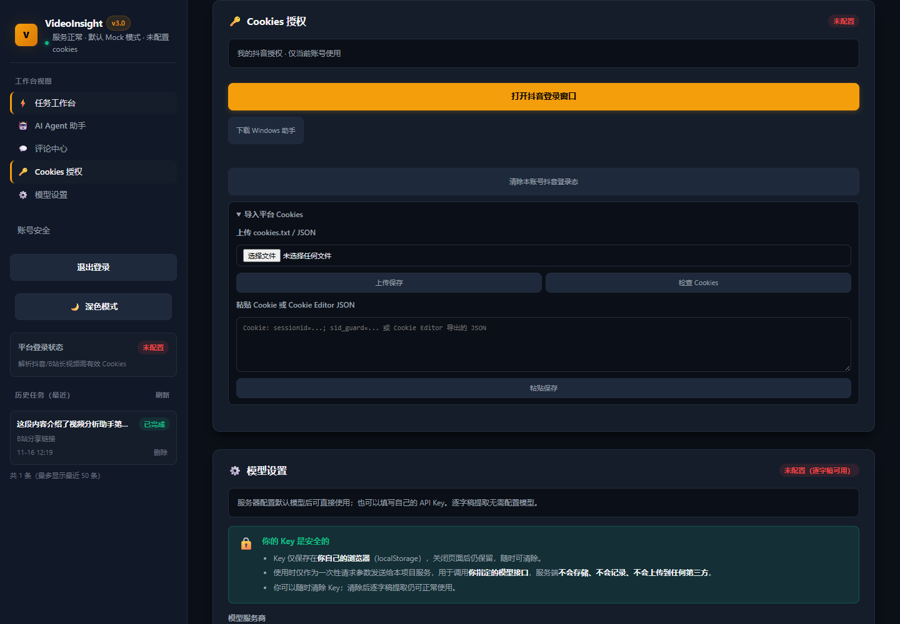
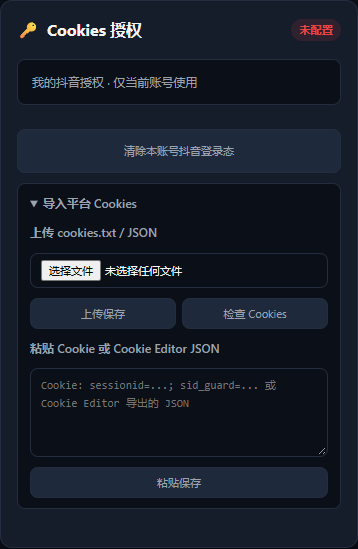
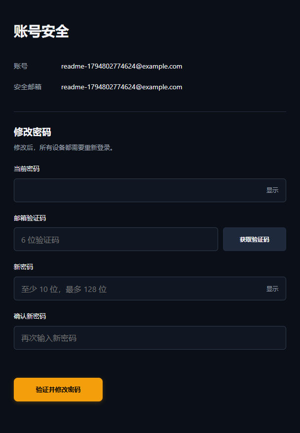
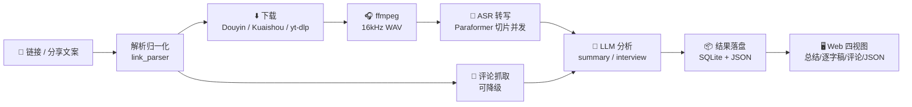

<div align="center">

# 🎬 VideoInsight Agent

**粘贴一条视频链接，拿回逐字稿、AI 总结、观众评论，以及一个可以追问的 AI 助手。**

[](https://www.python.org/)
[](https://fastapi.tiangolo.com/)
[](./tests)
[](https://dashscope.aliyuncs.com/)

</div>

---

## ✨ 能力一览

| | 能力 | 说明 |
|:--:|---|---|
| 🔗 | **链接即分析** | 支持抖音 / B站 / 小红书 / 快手，短链、分享文案直接往里贴，自动裁剪出干净链接 |
| 📄 | **逐字稿** | DashScope Paraformer 转写，带时间戳；长音频自动切片并发处理 |
| 🧠 | **AI 总结** | 结构化摘要；另有 `interview` 模式专门做面经/知识点提取 |
| 💬 | **观众评论** | 独立评论中心支持分页、回复与导出；未部署服务时可降级为热门样本 |
| 🤖 | **AI 追问** | 针对已完成的任务继续提问，模型只依据该视频的转写稿作答 |
| 📤 | **本地上传** | 分片上传、暂停与断点续传，上传完成后进入分析队列 |
| 🗂️ | **历史与隔离** | SQLite 持久化；注册用户按签名账号隔离，跨设备访问自己的任务 |
| 🔑 | **账号安全** | 邮箱验证码注册、忘记密码与修改密码；管理员与普通用户独立授权 |
| | **本地登录助手** | Windows 打开独立抖音窗口，登录后自动保存到当前网站账号；手机保留扫码与导入 |
| 🎨 | **沉浸式前端** | 结果四视图、媒体在线播放与下载、深浅色主题切换 |

---

## 界面截图

以下截图来自隔离测试账号，工作台使用 Mock 示例，不包含真实平台凭据或真实用户数据。

**任务工作台**



**电脑版 Cookies 授权**



| 手机端授权（合成授权测试账号） | 账号安全 |
|---|---|
|  |  |

---

## 🚀 快速开始

```powershell
python -m venv .venv
.\.venv\Scripts\Activate.ps1
pip install -r requirements.txt
copy .env.example .env
uvicorn app.main:app --reload --host 127.0.0.1 --port 8000
```

| 入口 | 地址 |
|---|---|
| 🖥️ Web 界面 | <http://127.0.0.1:8000/> |
| 📚 API 文档 | <http://127.0.0.1:8000/docs> |
| 💚 健康检查 | <http://127.0.0.1:8000/health> |

> **开箱即用**：默认 `VIDEOINSIGHT_MOCK_MODE=true`，不装 ffmpeg、不配 ASR/LLM 密钥也能先把接口和整条工作流跑通。

---

## 🧠 三种分析模式

| 模式 | 产出 | 适合 |
|---|---|---|
| `transcript` | 带时间戳的纯逐字稿 | 只要文字，不调 LLM |
| `summary` | 结构化 AI 总结 | 快速掌握视频讲了什么 |
| `interview` | 面经 / 知识点提取 | 技术分享、经验复盘类内容 |

```powershell
curl -X POST http://127.0.0.1:8000/analyze `
  -H "Content-Type: application/json" `
  -d "{\"url\":\"https://example.com/video\",\"mode\":\"summary\",\"use_mock\":true}"
```

命令行同样可用：

```powershell
python cli.py "https://example.com/video" --mode summary
python cli.py "https://example.com/video" --mode interview
```

---

## 🔗 平台支持

| 平台 | 实现方式 | 是否需要 Cookies |
|---|---|---|
| 🎵 抖音 | 内置 `DouyinShareDownloader`（移动分享页 SSR + 无水印直链） | 需要 `ttwid`（见下方说明） |
| ⚡ 快手 | 内置 `KuaishouDownloader`（移动端分享页解析） | 否 |
| 📺 B站 | 详情/播放 API 解析 + yt-dlp 下载音视频流 | 公开视频通常不需要；权限视频需对应登录态 |
| 📕 小红书 | yt-dlp | 否 |
| 🌐 YouTube | yt-dlp，支持正规视频和 Shorts 链接 | 视视频权限而定 |
| 🌐 其他 | 本地或管理员可使用 yt-dlp 通用提取；普通账号仅接受支持平台的正规单视频链接 | 视平台而定 |

> **抖音下载路径**：本项目默认解析移动分享页的 SSR 视频数据，不依赖 yt-dlp 的抖音详情提取器。
> 登录态、地区、平台风控和页面结构变化仍可能影响解析；重新登录并不能保证解决所有 403。

> **B 站 HTTP 412**：普通视频及 `b23.tv` 分享短链通过详情和播放 API 解析，
> 再将音视频流交给 yt-dlp 下载，避免访问被风控的视频 HTML。支持 BV/av 链接和 `?p=2` 分 P。
> 详情接口被 412 拦截时自动改用分 P 接口取得标题、时长和播放编号；此时无法取得的 UP 主信息留空。
> 如 API 也触发风控，页面会提示稍后重试、上传 B 站 Cookies 或上传本地视频。

> **B 站 HTTP 567**：下载使用 1 MiB Range 分块，避免部分 CDN 对整文件请求的拒绝。
> 保留 API 返回的备用节点，下载前检查所选候选地址；失败候选自动跳过。
> 每次外层重试重新获取签名地址，节点内部重试限制为 2 次；分段缺失时直接报错，不返回残缺视频。

---

## 💬 观众评论

评论分为独立评论中心和旧版分析内嵌评论两条链路：

```text
配置 COMMENT_CRAWLER_URL + COMMENT_CRAWLER_TOKEN → 后台评论任务 → 评论中心
未配置独立服务 → 优先读取配置的 MediaCrawler 评论源 → 抖音热门样本兜底
```

- **评论中心 `/comments`**：支持后台分页采集一级评论和子评论、去重、断点续抓；
  支持按点赞数、发布时间和入库顺序排序，筛选一级/全部/仅子评论，展开楼层回复。
- **热评前 10**：从当前任务已采集、符合范围筛选的所有评论中按点赞数选取，
  不是仅对当前页排序，也不等于平台推荐热榜；未抓完时排名仍可能变化。
- **导出**：保留全量 JSONL 导出，另可按当前筛选导出（包括前 10 条）。
- **分析内嵌评论**：已有数据同样支持排序、范围筛选和前 10；
  配置独立服务时通过链接进入评论中心，首次视频总结不等待后台评论。

旧版抖音直连在项目既有验证中仅返回约 10 条一级热门样本，不提供可用分页及回复。
界面会明确标注样本范围，修改 `count` 不能让它变成完整评论区。
获取更多评论需部署独立评论服务并提供有效的平台登录态，参见 [部署说明](deploy/comments.md)。
采集范围仅限当前账号可见、平台接口实际返回的内容；无法恢复已删除、隐藏或权限受限的评论。

本机接入 MediaCrawler（Git、uv、Node.js 已安装，无需 Docker）：

```powershell
.\.venv\Scripts\python.exe -m crawler_service.manage install
.\.venv\Scripts\python.exe -m crawler_service.manage start
```

安装器使用固定源码版本及独立 `.venv-comments`，完成四平台接口和 Chromium 自检后配置 `.env`。
重启主应用，在 `/comments` 导入平台 Cookies 后创建抓取任务。Windows `restart.bat`
会自动启动已安装的评论服务；`python -m crawler_service.manage check` 可再次自检。
上游使用非商业学习许可，商业化前须先确认授权。

评论抓取失败不会阻断主分析链路；后台任务保留已采集内容和状态。

---

## 🤖 AI 追问

任务完成后可以继续提问，模型只依据该任务的转写稿作答：

```powershell
curl -X POST http://127.0.0.1:8000/tasks/<task_id>/chat `
  -H "Content-Type: application/json" `
  -d "{\"question\":\"这段里提到的三个步骤分别是什么？\"}"
```

对话支持用户自备模型配置（请求体里带 `llm_provider` / `llm_api_key` 等），不填则用服务端配置。

---

## 📡 API 一览

| 方法 | 路径 | 用途 |
|---|---|---|
| `POST` | `/analyze` | 提交链接分析 |
| `POST` | `/analyze-file` | 整文件上传分析（保留兼容） |
| `GET` | `/uploads/config` | 查询上传大小上限、分片大小和保留期 |
| `POST` | `/uploads` | 初始化分片上传；支持初始化幂等标识 |
| `GET` | `/uploads/{id}` | 查询已确认分片，刷新或重启后恢复 |
| `PUT` | `/uploads/{id}/chunks/{index}` | 上传单个分片，校验内容并支持重复请求 |
| `POST` | `/uploads/{id}/complete` | 校验合并文件并提交分析；重复完成返回同一任务 |
| `DELETE` | `/uploads/{id}` | 取消未完成上传并清理分片 |
| `POST` | `/parse-link` | 从分享文案解析干净链接与标签 |
| `GET` | `/tasks` | 历史任务列表（按客户端身份隔离） |
| `GET` | `/tasks/{id}` | 查询任务与结果 |
| `POST` | `/tasks/{id}/used` | 记录首次使用时间（复制成功后标记，按客户端身份隔离） |
| `DELETE` | `/tasks/{id}` | 删除任务并清理产物 |
| `POST` | `/tasks/{id}/chat` | 基于转写稿追问 |
| `GET` | `/tasks/{id}/media` | 在线预览媒体（支持 Range） |
| `GET` | `/tasks/{id}/video` | 下载源视频（mp4） |
| `POST` | `/cookies` | 上传 `cookies.txt` |
| `DELETE` | `/cookies` | 清除本账号的抖音登录态，保留其他平台授权和历史任务 |
| `GET` | `/cookies/status` | 查看 Cookies 状态 |
| `POST` | `/cookies/qr/start` | 启动网页内扫码（已配置私有浏览器）或本地桌面登录 |
| `GET` | `/cookies/qr/{session_id}/status` | 查询本客户端扫码状态与二维码 |
| `DELETE` | `/cookies/qr/{session_id}` | 取消本客户端的网页扫码会话 |
| `POST` | `/cookies/browser/*` | 专用浏览器窗口抓取登录态 |
| `POST` | `/cookies/helper/start` | 为当前账号创建 Windows 本地助手授权 |
| `GET` | `/cookies/helper/{id}/status` | 查询当前账号的本地授权结果 |
| `DELETE` | `/cookies/helper/{id}` | 取消当前账号的本地授权 |
| `GET` | `/cookies/helper/download` | 下载 Windows 本地登录助手 |
| `GET` | `/health` | 探活（含是否启用鉴权） |
| `POST` | `/auth/session` | 用访问令牌换取鉴权 Cookie |
| `POST` | `/auth/login` | 管理员账号或已验证邮箱登录 |
| `POST` | `/auth/register/code` | 发送邮箱注册验证码 |
| `POST` | `/auth/register` | 校验邮箱验证码，创建账号并登录 |
| `GET` | `/auth/me` | 当前账号、绑定邮箱和邮件服务状态（不含凭据） |
| `GET` | `/forgot-password` | 忘记密码页面 |
| `GET` | `/account` | 登录后的账号安全页面 |
| `POST` | `/auth/password/reset/code` | 向账号绑定邮箱发送重置验证码，统一响应 |
| `POST` | `/auth/password/reset` | 校验验证码并重置密码，不自动登录 |
| `POST` | `/auth/password/change/code` | 校验当前密码后发送改密验证码 |
| `POST` | `/auth/password/change` | 校验当前密码和邮箱验证码后修改密码 |
| `POST` | `/auth/email/bind/code` | 未绑定邮箱的管理员验证当前密码后发送绑定验证码 |
| `POST` | `/auth/email/bind` | 验证当前密码和验证码，首次绑定管理员安全邮箱 |

> 启用账号登录或共享令牌后，业务端点默认受保护；登录、注册、重置密码、
> 静态资源和探活等公开入口例外。改密和绑定邮箱必须持有账号登录会话，
> 不能只用共享令牌。

<details>
<summary><b>历史记录与删除</b></summary>

任务与结果持久化在 SQLite（默认 `data/videoinsight.db`，可用 `VIDEOINSIGHT_DB_PATH` 修改）。

```powershell
curl "http://127.0.0.1:8000/tasks?limit=50"
curl "http://127.0.0.1:8000/tasks?status=succeeded"
curl -X DELETE http://127.0.0.1:8000/tasks/<task_id>
```

注册账号的任务归属由服务器验证的签名会话决定，`X-Client-Id` 不能指定其他账号。
管理员的既有浏览器历史和未启用账号的本地模式仍兼容 `client_id`。

> **归属规则（严格匹配）**：请求身份必须与任务归属完全一致，否则一律 404。
> 不带 `X-Client-Id` 提交的任务归属为"无身份"，只能被同样不带身份的请求看到 ——
> 它既不会对带身份的客户端开放，也不会从历史列表里消失。
>
> ⚠️ 旧版 `client_id` 是浏览器自造的 UUID，**不是身份认证**。不要把共享令牌
> 或未鉴权的本地模式当作多用户安全边界；公网多用户部署应启用账号登录。

</details>

<details>
<summary><b>邮箱注册与账号登录</b></summary>

先设置管理员账号 `VIDEOINSIGHT_AUTH_USERNAME`、PBKDF2 哈希
`VIDEOINSIGHT_AUTH_PASSWORD_HASH` 和持久化的 `VIDEOINSIGHT_SESSION_SECRET`。
管理员登录保持兼容，原浏览器历史不会重新归属或自动公开给注册用户。

在私有环境文件中配置以下变量并重新创建应用容器：

```dotenv
VIDEOINSIGHT_REGISTRATION_ENABLED=true
VIDEOINSIGHT_SMTP_HOST=smtp.qq.com
VIDEOINSIGHT_SMTP_PORT=465
VIDEOINSIGHT_SMTP_USERNAME=your-mailbox@qq.com
VIDEOINSIGHT_SMTP_PASSWORD=
```

SMTP 密码应为邮箱授权码，不是邮箱登录密码；不要提交真实配置到 Git。
邮件通过验证证书的 TLS 连接发送，不支持明文 SMTP。配置不完整或注册开关
关闭时，页面隐藏注册入口，接口拒绝注册，不影响已有账号登录。

登录页选择「邮箱注册」，验证邮箱并设置至少 10 位密码即可自动登录。
验证码为 6 位、10 分钟有效、仅能使用一次，错误 5 次后失效。
同邮箱 60 秒内不能重发；每邮箱每小时最多 10 次、每来源 IP 每小时 20 次，
全局每小时 50 次、每天 200 次。发信计数和验证码摘要保存在 SQLite，
重启不重置限流；验证码原文和 SMTP 授权码不返回浏览器。

注册账号的任务、媒体和评论归属由服务器签名会话决定，不能通过
`client_id`、`X-Client-ID` 或浏览器身份 Cookie 指定，可跨设备登录访问。
注册账号可在「Cookies 授权」中扫码登录自己的抖音，或导入自己的授权。
Cookies 按账号独立保存在数据库目录旁的 `account-cookies/<账号摘要>/cookies.txt`，
不放在公开媒体目录；后台任务与重启恢复均使用任务所属账号的授权。
未授权或授权失效时，不会回退到管理员文件、系统浏览器或管理员专用登录窗口。
管理员现有授权保留，不会复制给注册账号。云端普通用户可使用 Windows 本地助手、
已启用的页内扫码服务或手动导入，不能使用服务器共享的桌面浏览器；
同一账号跨设备登录仍使用本人的授权。
账号和验证码表与任务共用数据库，备份时一并保留。

登录页的「忘记密码」通过已注册或已绑定的安全邮箱验证身份；登录后的
「账号安全」支持修改密码，同时校验当前密码和邮箱验证码。新密码仍为
10 至 128 位。改密成功后不自动登录，所有设备的旧签名会话立即失效，
账号 ID 和历史任务保持不变。

「退出登录」会撤销当前设备的签名会话和待完成的助手授权，复制的旧会话不能继续使用；
其他设备的正常会话不受单次退出影响。共享 API 令牌不是账号会话，需要运维单独轮换。

管理员首次使用恢复功能前，须在「账号安全」中用当前密码和邮箱验证码
绑定本人邮箱。不会将 SMTP 发件邮箱默认当作管理员的恢复邮箱，也不支持
通过当前登录会话直接换绑邮箱。绑定后的管理员可用原账号名或安全邮箱登录。
管理员密码更新和邮箱绑定保存在私有 SQLite 中，不会重写环境文件；
运维主动更换 `VIDEOINSIGHT_AUTH_PASSWORD_HASH` 时，以新的引导密码为准，
旧密码覆盖记录及邮箱绑定停用，须重新验证绑定。

注册、绑定、改密、重置验证码按用途隔离，不能互用。各操作的验证码
10 分钟有效、单次使用、错误 5 次失效，同操作同邮箱有 60 秒重发冷却；
每小时和每日邮件配额由各用途共同使用。SMTP 配置完整时，即使关闭新用户
注册，已有账号仍可恢复或修改密码。未绑定邮箱的管理员不能走忘记密码恢复。

反向代理部署时，将 `VIDEOINSIGHT_TRUSTED_PROXY_IPS` 设为实际代理的对端 IP；
仅对这些对端信任 `X-Real-IP`，并确保代理覆盖此头。不会使用调用方的
`X-Forwarded-For`。不要设置任意公网来源。
公网必须自行启用 HTTPS。开放注册会允许验证过邮箱的用户使用服务器已配置
的云端模型和全局任务队列，请根据资源预算决定是否开放。

</details>

<details>
<summary><b>访问鉴权（可选）</b></summary>

共享令牌模式默认**不启用**。设置 `VIDEOINSIGHT_AUTH_TOKEN` 后，可用以下方式访问
受保护的 API；有效的邮箱账号登录会话同样可以通过鉴权，不需要再填写共享令牌。
公开页面、健康检查及受单独凭证保护的登录回调不要求此令牌。
不设置共享令牌不代表关闭已配置的账号登录或管理员密码保护。

```powershell
# 方式一：Bearer（脚本 / curl / 第三方集成）
curl -H "Authorization: Bearer <token>" http://127.0.0.1:8000/tasks
# 方式二：专用头
curl -H "X-Auth-Token: <token>" http://127.0.0.1:8000/tasks
```

Web 界面在「访问令牌」面板填入令牌，验证通过后自动记住。

> **为什么还有 Cookie 这条路**：媒体预览和下载是浏览器通过 `<video src>` /
> `<a href>` 发起的**原生请求**，这类请求带不了自定义请求头。前端因此调用
> `POST /auth/session` 把令牌换成 HttpOnly Cookie —— 少了这条通道，开启鉴权
> 会直接打断媒体播放和下载。`/docs` 同理：Swagger UI 由浏览器发起同源请求，
> 会自动带上 Cookie，所以鉴权后它是完整可用的。

设计取舍：用中间件而不是逐个路由加依赖 —— 路由会越加越多，漏掉一个就是一个
洞；中间件按"默认拒绝 + 公开白名单"工作，新路由自动受保护。令牌比较使用
`secrets.compare_digest`，避免计时侧信道。

> ⚠️ 共享令牌本身是**单个共享密钥**，不区分邮箱账号，也不负责 TLS。适合
> 反向代理之后或私有网络内的部署；直接裸奔在公网上仍需自行加一层认证与限流。

</details>

<details>
<summary><b>上传文件分析</b></summary>

不依赖任何平台风控，是当前最稳定的主链路。

```powershell
curl -X POST http://127.0.0.1:8000/analyze-file `
  -F "file=@C:\path\to\your-video.mp4" `
  -F "mode=summary" `
  -F "use_mock=false"
```

文件暂存于 `media/<task_id>/`。

网页上传使用分片协议：默认每片 4 MiB，最多 3 片并发。传输前逐块计算完整
SHA-256，每个分片也单独校验；失败分片最多自动重试 3 次，进度按服务端已确认字节显示。
可以暂停后继续。刷新页面或服务重启后，重新选择原文件并点击上传，会跳过已确认分片。
浏览器不会在刷新后自动重新读取本地文件，需要用户再次选择；相同文件名但内容不同的文件不会混传。

未完成会话默认保留 24 小时，每个身份最多保留 4 个未完成上传，声明的总文件大小
最多为单文件上限的 2 倍。取消上传会释放分片和配额；过期分片在新建上传、启动及周期清理时回收。
上传状态和分片保存在 `data/tmp/_uploads/<upload_id>/`，请在容器部署中持久化临时目录。
在现有单服务任务队列部署中，重复完成请求返回同一任务；队列满时保留分片，允许稍后继续提交。
上传模型参数只在完成请求传递，密钥不写入上传会话。

第三方接入顺序：

1. `POST /uploads`，JSON 包含 `filename`、`size`（字节）、完整文件的 `sha256`。
   可带 32 位小写十六进制 `idempotency_key`，重试时复用相同值。
2. 根据响应的 `chunk_size` 和 `uploaded_chunks`，向缺失的分片序号发送
   `PUT /uploads/{id}/chunks/{index}`。请求体为原始字节，
   `Content-Type: application/octet-stream`，`X-Chunk-SHA256` 为该分片的 SHA-256。
3. `POST /uploads/{id}/complete`，JSON 包含 `mode`、`use_mock` 及可选模型配置；
   成功返回 `202` 和原有格式的 `task_id`、`status_url`。

这些接口沿用现有账号会话、共享令牌和客户端归属。上传续传仅恢复文件传输；
转写、AI 分析任务中断后的处理仍遵循任务队列原有的重启对账规则。

</details>

<details>
<summary><b>媒体预览与下载</b></summary>

```powershell
# 浏览器内联预览
curl http://127.0.0.1:8000/tasks/<task_id>/media

# 下载转写用音频
curl -o output.mp3 "http://127.0.0.1:8000/tasks/<task_id>/media?download=1"

# 下载源视频（完整画面，按需下载并缓存为 mp4）
curl -o output.mp4 "http://127.0.0.1:8000/tasks/<task_id>/video?download=1"
```

</details>

---

## 🧹 产物回收

**数据库是唯一事实来源**：任务产物放在以 `task_id` 命名的目录里，所以
「目录存在、库里没有记录」= 纯垃圾。服务启动时对账一次，之后每
`VIDEOINSIGHT_CLEANUP_INTERVAL_HOURS` 小时再来一次，回收三类东西：

| 回收对象 | 说明 |
|---|---|
| 孤儿任务目录 | 删除任务时清理失败、或进程被中断留下的残渣 |
| 终态任务的转写中间 WAV | ASR 的内部输入，转写完无人再读；一小时音频约 **115 MB** |
| 过期任务记录 | 仅当 `VIDEOINSIGHT_TASK_RETENTION_HOURS > 0`（默认关闭） |

三条安全边界：

- 只处理名字**严格等于** 32 位十六进制 `task_id` 的目录 —— 手工造的 `tmp/realtest/` 之类不会被误删。
- 下划线开头的条目**永不触碰** —— `media/_cookies`（登录态）与 `media/_browser_profiles`（专用浏览器配置）是用户资产，不是产物。
- 中间产物只清理 **`succeeded` / `failed`** 的任务，且按 `task_id` 前缀精确匹配 —— 正在跑的任务，以及用户上传的、恰好叫 `*-16k.wav` 的源文件，都不会被删。

> 回收是尽力而为的：任何失败只记日志，绝不影响服务启动。

---

## 🧵 并发与重启对账

长任务不再挂在 FastAPI 的 `BackgroundTasks` 上，而是走**专用的有界线程池**
（默认核心并发 2、最大并发 4、等待队列容量 32）。

工作台展示任务状态、真实处理阶段、进度和队列位置。提交链接或上传文件后立即入队，
点击任务进入独立的 `/view/{task_id}` 视频详情页，刷新可继续查看同一任务。

调度顺序为：先使用核心执行槽位，再进入有界 FIFO 等待队列；等待队列满后，
可扩展至最大并发。全部容量用尽时返回 `429` 和 `Retry-After`，不阻塞网页请求，
也不会留下永远排队的任务记录。配置修改后重启生效：

```env
VIDEOINSIGHT_TASK_CORE_WORKERS=2
VIDEOINSIGHT_MAX_CONCURRENT_TASKS=4
VIDEOINSIGHT_TASK_QUEUE_CAPACITY=32
DASHSCOPE_ASR_GLOBAL_WORKERS=8
```

`DASHSCOPE_ASR_MAX_WORKERS` 仍控制单条视频的分片并发；新增的全局限制控制所有
视频合计的识别请求数，避免多个任务各自开启 8 路后叠加冲击配额。
当前语音识别和总结调用云端接口，未启用本地 GPU 推理；NVENC 视频编码加速
不能替代云端 ASR/LLM 加速。本次不安装本地模型、不下载模型权重。

**为什么要换**，原来的做法有三个问题：

1. `BackgroundTasks` 把同步任务丢进 anyio 的默认线程池，而**所有同步端点共用
   同一个池**（默认 40 个工人）。一个视频任务动辄十几分钟，几个并发就能把池子
   占满，连 `GET /tasks` 都不再响应。
2. 没有并发上限：N 次提交 = N 路同时下载 + 转写，打满带宽、磁盘和 ASR 配额。
3. 进程重启后，库里停在 `queued` / `running` 的任务永远没人管 —— 既跑不完也
   不失败，只会作为僵尸记录一直躺在历史列表里。

前两条由专用有界池解决（业务是 IO 与子进程密集型，GIL 不是瓶颈），第三条靠
**启动对账**：

| 遗留状态 | 处理 | 理由 |
|---|---|---|
| `running` | 标记失败 | 进程死了任务必然被中断，而链路**没有断点续传** —— 磁盘上的半成品不可信。让用户明确重试，比伪装成"还在跑"诚实 |
| `queued` | 重新入队 | 从未开始，没有部分状态，提交意图明确。上传型任务需要原始文件还在，否则只能失败并说明原因 |

一个副作用值得知道：`POST /analyze` 现在**立即返回**，不再等任务跑完才回响应。客户端必须轮询 `/tasks/{id}` 拿结果（前端本来就是这么做的）。

---

## ⚙️ 切换真实链路

1. 安装系统 `ffmpeg` 并加入 PATH（没装则回退到 `imageio-ffmpeg` 内置二进制）。
2. 安装 ASR 依赖：`pip install -r requirements-asr.txt`
3. 修改 `.env`：

```env
VIDEOINSIGHT_MOCK_MODE=false
DASHSCOPE_API_KEY=你的 DashScope Key
LLM_PROVIDER=deepseek
DEEPSEEK_API_KEY=你的 DeepSeek Key
LLM_BASE_URL=https://api.deepseek.com/v1
LLM_MODEL=deepseek-flash
```

真实链路：下载 → `ffmpeg` 转 16kHz 单声道 WAV → DashScope Paraformer 转写
（默认超过 **120 秒**切成 **120 秒**片段，最多 **8** 路并行）→ OpenAI-compatible LLM 调用。

### 网页配置转写服务

在新建任务区域的“语音转写服务”下，展开“配置转写服务 / API Key”。选择硅基流动、Cloudflare、Groq 或离线 Whisper，填写对应凭据后点击“保存并应用”，即可在上方选择器切换。勾选“设为我的默认服务”会保存当前账号的新任务默认值。离线 Whisper 无需密钥，模型由服务器管理员部署。

凭据按登录账号隔离，保存在数据库同目录的 `asr-settings/` 私有文件中（Linux 目录权限 0700、文件权限 0600），不会通过接口回显或写入任务记录。备份该目录时按密钥文件管理。输入框留空保留原密钥；“清除本账号配置”只移除个人覆盖，服务器环境变量保持有效。

“检查已保存配置”只检查凭据、网络和策略，不上传音频，也不能替代真实转写验证。SenseVoiceSmall 免费，仅支持纯文本；Cloudflare 在上传前核验免费计划；Groq 需要本人确认免费账号，个人 Key 默认直连。已排队任务和重试任务继续使用原服务及提交时的授权范围。

单独选择“Qwen3-ASR（付费）”并勾选付费授权，可使用个人 Key 调用硅基流动 Qwen。离线 Whisper 提供真实语音片段边界，Qwen 转写各片段，保留字幕导出。勾选免费兜底后，第一个付费片段失败即停止后续付费请求，保留已经成功的 Qwen 文本，其余采用离线结果。可随时撤销授权，后续片段上传前会重新检查。不会自动升级套餐或转发到其他云服务；代金券是否适用需以服务商账单和券详情为准。

### Groq Whisper 转写

可仅替换语音转写，不改变 AI 总结模型。在本机 `.env` 配置：

```env
ASR_PROVIDER=groq
GROQ_API_KEY=你的 Groq Key
GROQ_ASR_MODEL=whisper-large-v3-turbo
GROQ_ASR_CHUNK_SECONDS=300
GROQ_ASR_MAX_WORKERS=2
GROQ_ASR_GLOBAL_WORKERS=2
GROQ_ASR_REQUESTS_PER_MINUTE=18
```

Groq 通过现有 `httpx` 调用，不需要安装 DashScope SDK。保留逐句时间戳、分片进度和
任务队列；默认每片 5 分钟，最多 10 分钟，转成 16kHz 单声道 WAV 后低于 25MB。
免费账号仍受音频时长、请求频率等配额限制，请在 Groq 控制台确认账号为 Free 计划。
项目不会代为开通付费计划，也不会在限流、额度不足或鉴权失败后回退到阿里云。
Key 仅保存在 Git 忽略的 `.env`，不会通过健康检查或任务诊断返回。

如果服务器直连 Groq 返回 403，但同一密钥经代理可以成功转写，可单独设置
`GROQ_PROXY_URL=http://代理地址:端口`（支持 HTTP/HTTPS 代理）。
该配置只影响 Groq，不会改变视频下载、DeepSeek 等服务的网络路径。
留空时沿用 `httpx` 的系统代理行为；显式配置后不会因为代理故障而自动改为直连。
代理地址和凭据也应只保存在私有 `.env`。Docker 中的 `127.0.0.1` 指向容器自身，
不能直接填写开发电脑或宿主机的回环地址。不要将无鉴权代理端口暴露到公网。

<details>
<summary><b>常用环境变量</b></summary>

| 变量 | 默认 | 说明 |
|---|---|---|
| `VIDEOINSIGHT_MOCK_MODE` | `true` | Mock 开关，关闭后走真实下载/ASR/LLM |
| `VIDEOINSIGHT_TMP_DIR` | `data/tmp` | 临时目录 |
| `VIDEOINSIGHT_RESULTS_DIR` | `data/results` | 结果落盘目录 |
| `VIDEOINSIGHT_MEDIA_DIR` | `media` | 媒体与 Cookies 目录 |
| `VIDEOINSIGHT_DB_PATH` | `data/videoinsight.db` | SQLite 路径 |
| `VIDEOINSIGHT_MAX_UPLOAD_MB` | `2048` | 单个上传文件大小上限 |
| `VIDEOINSIGHT_UPLOAD_CHUNK_BYTES` | `4194304` | 分片大小（字节），服务端最大允许 16 MiB |
| `VIDEOINSIGHT_UPLOAD_RETENTION_HOURS` | `24` | 未完成上传保留时长（至少 1 小时） |
| `VIDEOINSIGHT_MAX_PENDING_UPLOADS` | `4` | 每个身份的未完成上传数量上限 |
| `VIDEOINSIGHT_AUTH_TOKEN` | — | 可选共享访问令牌；有效账号会话也可鉴权，不设置不会关闭其他登录保护 |
| `VIDEOINSIGHT_TASK_CORE_WORKERS` | `2` | 核心任务并发；不会超过最大并发 |
| `VIDEOINSIGHT_MAX_CONCURRENT_TASKS` | `4` | 等待队列满时允许扩展到的最大任务并发 |
| `VIDEOINSIGHT_TASK_QUEUE_CAPACITY` | `32` | FIFO 等待队列容量；全部占满后拒绝新提交 |
| `VIDEOINSIGHT_CLEANUP_INTERVAL_HOURS` | `6` | 产物回收周期；`<=0` 只保留启动时那一次 |
| `VIDEOINSIGHT_TASK_RETENTION_HOURS` | `0` | 任务记录保留时长；`0` = 永久保留历史，只回收孤儿文件 |
| `DASHSCOPE_ASR_CHUNK_THRESHOLD_SECONDS` | `120` | 超过该时长开始并发切片；短音频也能避开单次请求固定开销 |
| `DASHSCOPE_ASR_CHUNK_SECONDS` | `120` | 每片时长 |
| `DASHSCOPE_ASR_MAX_WORKERS` | `8` | 并发转写路数；过高可能触发服务商限流 |
| `DASHSCOPE_ASR_GLOBAL_WORKERS` | `8` | 所有视频合计的转写调用并发上限 |
| `YTDLP_COOKIES_FROM_BROWSER` | — | 复用本机浏览器 Cookies，如 `chrome` / `edge` |
| `YTDLP_COOKIES_FILE` | — | Netscape 格式 `cookies.txt` 路径 |
| `COOKIE_LOGIN_MODE` | `auto` | 优先使用已配置的网页扫码；`remote` 网页扫码，`import` 仅导入，`desktop` 本地桌面 |
| `COOKIE_QR_BROWSER_URL` | — | 私有登录浏览器 CDP 地址，设置后 `auto` 启用网页内扫码 |
| `MEDIA_CRAWLER_OUTPUT_DIR` | — | MediaCrawler 评论落盘目录 |
| `MEDIA_CRAWLER_API_URL` | — | MediaCrawler API 地址 |

</details>

---

## 🍪 抖音 Cookies

当前抖音下载流程需要有效的 `ttwid` Cookie；建议先完成授权再解析抖音视频。
账号权限、登录态、地区和平台风控仍可能影响解析，其他平台的要求见上方支持平台表。

**服务器 / Docker：网页扫码登录**

在与应用相同的私有 Docker 网络启动隔离登录浏览器：

```bash
docker compose -f deploy/qr-browser/compose.yaml up -d
```

为应用配置 `COOKIE_QR_BROWSER_URL=http://videoinsight-qr-browser:9222`，
保留 `COOKIE_LOGIN_MODE=auto` 或设为 `remote`，然后重建应用容器。
网页「Cookies 授权」点击登录按钮即可看到抖音二维码，用抖音 App 扫码并确认。
登录成功后自动保存 Cookies，并重试当前待授权链接。可以刷新或取消二维码，
会话最多保留 3 分钟；完成、失败、取消或超时后都会销毁隔离浏览器上下文。
服务只允许一个活跃扫码会话，状态和取消操作按客户端隔离。
保存时原子替换抖音登录态，保留其他平台 Cookies；登录凭据不返回网页。

浏览器没有持久化账号配置，也不开放远程桌面。**不要发布 9222 端口到公网**，
不要将 CDP 地址放进前端代码。镜像固定摘要，容器设有内存、CPU 和进程数上限。
扫码只能授权你确认的账号，不能保证绕过平台的访问限制或验证码。

**文件或文本导入**

未配置扫码浏览器且没有桌面环境时，自动展示手动导入。
`COOKIE_LOGIN_MODE=import` 可显式禁用扫码。

在自己的浏览器导出 Netscape `cookies.txt` 或含域名的 Cookie Editor JSON，
然后上传保存；抖音 Cookie 请求头文本也可粘贴保存。保存后无需重启。
原始 Cookie 请求头没有域名信息，当前按抖音处理，其他平台请使用含域名的文件或 JSON。
Cookies 是敏感登录凭据，请仅导入自己信任的服务，并使用 HTTPS 或 SSH 加密隧道，
不要提交到 Git。

**清除本账号授权**

在「Cookies 授权」点击「清除本账号抖音登录态」并确认。仅移除本账号保存的
抖音 Cookie，同时取消本账号的扫码会话并清理评论服务中的对应授权副本。
其他账号、其他平台 Cookies、历史任务和应用账号登录不受影响。
清除后禁止后台自动读取浏览器来恢复旧授权；重新扫码或显式导入后恢复使用。
这不会登出手机抖音，也不会撤销抖音平台上的其他设备会话。
应用账号需退出时，使用侧栏「退出登录」。

**本地桌面：扫码登录**

管理员在本地桌面模式下，可通过「Cookies 授权」扫码登录，默认保存在
`media/_cookies/cookies.txt`，无需重启服务。注册账号只使用前述账号私有路径，
不会读取这个管理员文件，也不能使用共享桌面窗口。

**本地桌面：专用浏览器窗口**

1. 点「打开登录窗口」，在项目专用窗口中登录抖音
2. 回网页点「检查窗口」，确认 DevTools 已连接且找到抖音页面
3. 点「抓取登录态」

> 只读取项目专用窗口的 Cookies，不碰你日常浏览器的配置。

**云端网站：Windows 本地登录助手**

在 HTTPS 网站的「Cookies 授权」下载并安装 Windows 助手。之后点击
「打开抖音登录窗口」，核对助手显示的目标账号，再在专用窗口完成抖音登录，
Cookies 会自动保存到当前网站账号。管理员和普通用户均可使用，各自授权独立。
每次使用新的临时浏览器配置，不复用管理员或上一个网站账号的本机登录态。
取消、过期、退出网站、改密或清除授权后，旧凭证不能重新写回 Cookies。
手机端仍可使用页内扫码和手动导入。

安装、构建、可信来源及安全边界详见 [本地登录助手](docs/local-login-helper.md)。

> ⚠️ 「抖音拒绝了当前请求」不能单独证明 Cookies 有效或已过期，也可能与账号权限、
> 地区或平台风控有关。可重新授权、稍后重试，或改用上传本地视频。

---

## 🧩 处理流程



> 评论抓取刻意排在下载之前：它只是一次轻量 HTTP 请求，不该被十几分钟的下载与转写拖着。

---

## 📁 项目结构

```text
app/
  main.py                  FastAPI 入口（任务、Cookies、媒体、对话）
  account_auth.py          账号登录、邮箱验证、密码恢复与会话撤销
  account_store.py         账号、验证码、配额与撤销会话的 SQLite 存储
  local_login.py           本地助手的一次性账号授权与自动保存
  remote_qr.py             隔离浏览器中的网页扫码、确认与状态轮询
  media_urls.py            普通账号的官方单视频 URL 规范化
  url_safety.py            公网目标验证、DNS 固定与原域名 TLS 校验
  workflow.py              固定工作流编排
  task_store.py            SQLite 持久化任务存储
  uploads.py               分片校验、上传状态持久化、合并提交与过期回收
  schemas.py               请求、任务和结果模型
  config.py                环境配置
  prompts.py               LLM Prompt 模板
  link_parser.py           分享文案 → 干净链接 + 标签
  browser_cookies.py       专用浏览器抓取登录态（DevTools 协议）
  qr_login.py              扫码登录抓取 cookies
  cookies.py               平台 cookies 归一化与摘要
  errors.py                统一错误类型
  adapters/
    downloader.py          Mock / 抖音 / 快手 / yt-dlp 下载器（select_downloader 路由）
    audio.py               ffmpeg 音频预处理
    asr.py                 Mock / Paraformer 转写（长音频切片并发）
    llm.py                 Mock / OpenAI-compatible LLM
    comment_fetcher.py     观众评论（抖音直连 + MediaCrawler 对接）
  task_queue.py            长任务的有界线程池与重启对账
  cleanup.py               产物回收（孤儿目录 / 中间文件 / 过期记录）
  security.py              可选的共享令牌鉴权中间件
web/
  index.html / app.js / styles.css   前端页面
  account.* / login.* / auth-common.js   登录、注册与账号安全
  local-login.js                     助手调用与可恢复的状态轮询
  resumable-upload.js                流式文件指纹、并发上传、暂停重试与续传
local_helper/                        Windows 助手、协议安装与构建
tests/                               Python、Node 与真实浏览器回归
verify_real_chain.py                 真实链路验证脚本
verify_kuaishou_video.py             快手全流程调试脚本
verify_comments_chain.py             评论链路验证脚本（mock 转写 + 真实评论接口）
docs/                                集成评估、评论数据产出、参赛材料
```

---

## 🧪 测试

```powershell
pip install pytest
pytest --basetemp=_pytest_tmp -q
node --test tests/*.test.cjs
```

2026-11-26 分片上传变更在隔离环境完成验证：默认 Python 测试 **793 passed / 7 skipped**，
Node 测试 **17 passed**。另用 Ego 浏览器验证暂停、刷新、服务重启及网络中断后的恢复，
确认跳过已上传分片、只创建一个分析任务，以及取消清理和 390px 布局。

2026-11-16 正式测试目录完整验证为 **776 passed / 0 failed**，
另有 **41 项部署脚本测试**和 **5 项 Node 测试**通过。
覆盖账号登录与邮箱验证码、改密与退出后的旧会话重放、跨账号 Cookies、
助手领取/保存/撤销及并发、官方视频 URL、DNS 固定和 TLS 原域名验证、
模型输出密钥脱敏，以及下载、转写、任务队列和产物回收。

普通 `pytest` 会跳过需要真实浏览器的可选集成测试。完整验证额外启用了
`HELPER_BROWSER_TEST=1` 和指向全新隔离 Chromium 的 `QR_TEST_BROWSER_URL`，
不使用日常浏览器配置；真实 TLS 测试使用可选的 `cryptography` 测试依赖。
测试进程清空本机鉴权环境覆盖，未修改私有 `.env`。有一条既有测试依赖弃用警告。
`pytest.ini` 限定默认收集 `tests`，不扫描 `output` 中的临时脚本和测试副本。

浏览器回归脚本包括 `tests/browser_local_helper_smoke.js`、
`tests/browser_password_smoke.js` 和 `tests/browser_qr_smoke.js`；
对隔离服务 `tests/password_browser_server.py` 验证授权、成功提示、刷新续查、
取消、错误恢复及 320/390/768/1440px 布局。截图由
`tests/browser_readme_screenshots.js` 在全新浏览器会话生成；手机扫码入口截图取自
`tests/browser_local_helper_live.js` 使用的线上临时测试账号，未进行真实抖音登录。

> 长任务改为异步执行后，`POST` 不再等任务跑完才返回，测试改用轮询（`tests/conftest.py`
> 的 `wait_for_task`）来断言终态 —— 这比原来的"提交完立刻断言 succeeded"更贴近真实契约。

---

## 🗺️ 边界与后续

**已完成**：API 提交/查询/列表/删除、文件上传分析、抖音免签名下载、观众评论抓取、AI 追问、
Mock 全链路闭环、可替换的下载/ASR/LLM 模块、SQLite 持久化、沉浸式 Web 前端、
有界并发与重启对账、产物自动回收、邮箱账号与密码恢复、账号独立 Cookies、
Windows 本地登录助手、移动端授权入口、可选的共享令牌鉴权。

**安全边界**：

- 注册与密码邮件接口有持久化配额；这不等于全站都有按用户计费或调用限流。
- 普通用户自备 LLM 地址仅允许公网 HTTP(S)，拒绝私网、混合 DNS 结果、重定向及含凭据的地址；
  连接固定到已校验的 IP，并保留原域名的 TLS 验证。管理员和服务端配置仍是受信任配置，可接内网模型。
- 普通账号只提交支持平台的正规视频地址，短链逐跳校验后规范化；通用 yt-dlp 仅用于本地或管理员。
  视频平台和其返回的 CDN 仍属于受信任的下载依赖，公网部署建议另加网络出口隔离。
  旧评论任务若不是规范化地址，重试会被拒绝，需要用完整官方链接重新创建。
- 上游模型错误与测试输出会过滤本次使用的 API Key；真实密钥、Cookies、浏览器状态和环境文件不得入库。
- `requirements.txt` 引入 `constraints-security.txt` 的补丁版本下限；可用 `pip-audit` 复查实际安装环境，
  这不是依赖锁文件，也不承诺未来没有新告警。
- Windows 助手未签名、不自动升级，不支持 macOS/Linux；手机使用扫码或手动导入。
  自动化验证使用合成 Cookies，真实抖音手机确认与平台风控仍需本人实测。
- HTTPS 由反向代理终止；公网账号登录和本地助手必须配置可信 HTTPS。

本轮已复现问题、修复与验证边界见 [安全回归记录](docs/security-review-20261116.md)。

**暂不包含**：Celery + Redis 分布式队列（目前是单机进程内线程池，任务不跨进程调度）、
飞书机器人、PostgreSQL、内容安全与事实核查、多模态画面分析。

---

<div align="center">

用得顺手的话，欢迎点个 ⭐

</div>
