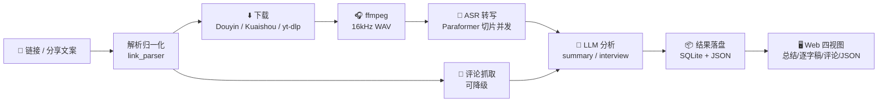

<div align="center">

# 🎬 VideoInsight Agent

**粘贴一条视频链接，拿回逐字稿、AI 总结、观众评论，以及一个可以追问的 AI 助手。**

[](https://www.python.org/)
[](https://fastapi.tiangolo.com/)
[](./tests)
[](https://dashscope.aliyuncs.com/)

</div>

---

## ✨ 能力一览

| | 能力 | 说明 |
|:--:|---|---|
| 🔗 | **链接即分析** | 支持抖音 / B站 / 小红书 / 快手，短链、分享文案直接往里贴，自动裁剪出干净链接 |
| 📄 | **逐字稿** | DashScope Paraformer 转写，带时间戳；长音频自动切片并发处理 |
| 🧠 | **AI 总结** | 结构化摘要；另有 `interview` 模式专门做面经/知识点提取 |
| 💬 | **观众评论** | 抖音走内置直连接口，零依赖抓取，并把评论一并喂给 LLM |
| 🤖 | **AI 追问** | 针对已完成的任务继续提问，模型只依据该视频的转写稿作答 |
| 📤 | **本地上传** | 拖进音频/视频文件即可分析，绕开一切平台风控 |
| 🗂️ | **历史与隔离** | 任务持久化在 SQLite，按浏览器身份隔离，重启不丢、互不串号 |
| 🔑 | **访问鉴权** | 可选的共享令牌（中间件默认拒绝 + 白名单），保护上传、Cookies 抓取与全部任务数据 |
| 🎨 | **沉浸式前端** | 结果四视图、媒体在线播放与下载、深浅色主题切换 |

---

## 🚀 快速开始

```powershell
python -m venv .venv
.\.venv\Scripts\Activate.ps1
pip install -r requirements.txt
copy .env.example .env
uvicorn app.main:app --reload --host 127.0.0.1 --port 8000
```

| 入口 | 地址 |
|---|---|
| 🖥️ Web 界面 | <http://127.0.0.1:8000/> |
| 📚 API 文档 | <http://127.0.0.1:8000/docs> |
| 💚 健康检查 | <http://127.0.0.1:8000/health> |

> **开箱即用**：默认 `VIDEOINSIGHT_MOCK_MODE=true`，不装 ffmpeg、不配 ASR/LLM 密钥也能先把接口和整条工作流跑通。

---

## 🧠 三种分析模式

| 模式 | 产出 | 适合 |
|---|---|---|
| `transcript` | 带时间戳的纯逐字稿 | 只要文字，不调 LLM |
| `summary` | 结构化 AI 总结 | 快速掌握视频讲了什么 |
| `interview` | 面经 / 知识点提取 | 技术分享、经验复盘类内容 |

```powershell
curl -X POST http://127.0.0.1:8000/analyze `
  -H "Content-Type: application/json" `
  -d "{\"url\":\"https://example.com/video\",\"mode\":\"summary\",\"use_mock\":true}"
```

命令行同样可用：

```powershell
python cli.py "https://example.com/video" --mode summary
python cli.py "https://example.com/video" --mode interview
```

---

## 🔗 平台支持

| 平台 | 实现方式 | 是否需要 Cookies |
|---|---|---|
| 🎵 抖音 | 内置 `DouyinShareDownloader`（移动分享页 SSR + 无水印直链） | 需要 `ttwid`（见下方说明） |
| ⚡ 快手 | 内置 `KuaishouDownloader`（移动端分享页解析） | 否 |
| 📺 B站 | 详情/播放 API 解析 + yt-dlp 下载音视频流 | 公开视频通常不需要；权限视频需对应登录态 |
| 📕 小红书 | yt-dlp | 否 |
| 🌐 其他 | yt-dlp 通用提取 | 视平台而定 |

> **为什么抖音不用 yt-dlp 了？**
> yt-dlp 的抖音提取器走 `www.douyin.com/aweme/v1/web/aweme/detail/`，该接口已强制 `a_bogus` 签名校验
> （yt-dlp 至 2026.08.19 仍未实现，源码仅留 TODO），**即使 Cookies 齐全也一律 403**，
> 报 `Fresh cookies are needed` —— 反复重新登录是无效的。

> **B 站 HTTP 412**：普通视频及 `b23.tv` 分享短链通过详情和播放 API 解析，
> 再将音视频流交给 yt-dlp 下载，避免访问被风控的视频 HTML。支持 BV/av 链接和 `?p=2` 分 P。
> 详情接口被 412 拦截时自动改用分 P 接口取得标题、时长和播放编号；此时无法取得的 UP 主信息留空。
> 如 API 也触发风控，页面会提示稍后重试、上传 B 站 Cookies 或上传本地视频。
> 本项目改走 `m.douyin.com` 移动分享页：SSR 数据里直接内嵌视频地址，再拼无水印直链下载。

> **B 站 HTTP 567**：下载使用 1 MiB Range 分块，避免部分 CDN 对整文件请求的拒绝。
> 保留 API 返回的备用节点，下载前检查所选候选地址；失败候选自动跳过。
> 每次外层重试重新获取签名地址，节点内部重试限制为 2 次；分段缺失时直接报错，不返回残缺视频。

---

## 💬 观众评论

评论分为独立评论中心和旧版分析内嵌评论两条链路：

```text
配置 COMMENT_CRAWLER_URL + COMMENT_CRAWLER_TOKEN → 后台评论任务 → 评论中心
未配置独立服务 → 优先读取配置的 MediaCrawler 评论源 → 抖音热门样本兜底
```

- **评论中心 `/comments`**：支持后台分页采集一级评论和子评论、去重、断点续抓；
  支持按点赞数、发布时间和入库顺序排序，筛选一级/全部/仅子评论，展开楼层回复。
- **热评前 10**：从当前任务已采集、符合范围筛选的所有评论中按点赞数选取，
  不是仅对当前页排序，也不等于平台推荐热榜；未抓完时排名仍可能变化。
- **导出**：保留全量 JSONL 导出，另可按当前筛选导出（包括前 10 条）。
- **分析内嵌评论**：已有数据同样支持排序、范围筛选和前 10；
  配置独立服务时通过链接进入评论中心，首次视频总结不等待后台评论。

旧版抖音直连在项目既有验证中仅返回约 10 条一级热门样本，不提供可用分页及回复。
界面会明确标注样本范围，修改 `count` 不能让它变成完整评论区。
获取更多评论需部署独立评论服务并提供有效的平台登录态，参见 [部署说明](deploy/comments.md)。
采集范围仅限当前账号可见、平台接口实际返回的内容；无法恢复已删除、隐藏或权限受限的评论。

本机接入 MediaCrawler（Git、uv、Node.js 已安装，无需 Docker）：

```powershell
.\.venv\Scripts\python.exe -m crawler_service.manage install
.\.venv\Scripts\python.exe -m crawler_service.manage start
```

安装器使用固定源码版本及独立 `.venv-comments`，完成四平台接口和 Chromium 自检后配置 `.env`。
重启主应用，在 `/comments` 导入平台 Cookies 后创建抓取任务。Windows `restart.bat`
会自动启动已安装的评论服务；`python -m crawler_service.manage check` 可再次自检。
上游使用非商业学习许可，商业化前须先确认授权。

评论抓取失败不会阻断主分析链路；后台任务保留已采集内容和状态。

---

## 🤖 AI 追问

任务完成后可以继续提问，模型只依据该任务的转写稿作答：

```powershell
curl -X POST http://127.0.0.1:8000/tasks/<task_id>/chat `
  -H "Content-Type: application/json" `
  -d "{\"question\":\"这段里提到的三个步骤分别是什么？\"}"
```

对话支持用户自备模型配置（请求体里带 `llm_provider` / `llm_api_key` 等），不填则用服务端配置。

---

## 📡 API 一览

| 方法 | 路径 | 用途 |
|---|---|---|
| `POST` | `/analyze` | 提交链接分析 |
| `POST` | `/analyze-file` | 上传本地文件分析 |
| `POST` | `/parse-link` | 从分享文案解析干净链接与标签 |
| `GET` | `/tasks` | 历史任务列表（按客户端身份隔离） |
| `GET` | `/tasks/{id}` | 查询任务与结果 |
| `POST` | `/tasks/{id}/used` | 记录首次使用时间（复制成功后标记，按客户端身份隔离） |
| `DELETE` | `/tasks/{id}` | 删除任务并清理产物 |
| `POST` | `/tasks/{id}/chat` | 基于转写稿追问 |
| `GET` | `/tasks/{id}/media` | 在线预览媒体（支持 Range） |
| `GET` | `/tasks/{id}/video` | 下载源视频（mp4） |
| `POST` | `/cookies` | 上传 `cookies.txt` |
| `GET` | `/cookies/status` | 查看 Cookies 状态 |
| `POST` | `/cookies/qr/start` | 扫码登录 |
| `POST` | `/cookies/browser/*` | 专用浏览器窗口抓取登录态 |
| `GET` | `/health` | 探活（含是否启用鉴权） |
| `POST` | `/auth/session` | 用访问令牌换取鉴权 Cookie |

> 除 `/`、`/static/*`、`/health`、`/auth/session` 外，**设置 `VIDEOINSIGHT_AUTH_TOKEN`
> 后所有端点都需要令牌**；不设置则全部开放。

<details>
<summary><b>历史记录与删除</b></summary>

任务与结果持久化在 SQLite（默认 `data/videoinsight.db`，可用 `VIDEOINSIGHT_DB_PATH` 修改）。

```powershell
curl "http://127.0.0.1:8000/tasks?limit=50"
curl "http://127.0.0.1:8000/tasks?status=succeeded"
curl -X DELETE http://127.0.0.1:8000/tasks/<task_id>
```

历史列表按浏览器生成的 `client_id` 隔离（请求头 `X-Client-Id`），看不到别人的任务。

> **归属规则（严格匹配）**：请求身份必须与任务归属完全一致，否则一律 404。
> 不带 `X-Client-Id` 提交的任务归属为"无身份"，只能被同样不带身份的请求看到 ——
> 它既不会对带身份的客户端开放，也不会从历史列表里消失。
>
> ⚠️ `client_id` 是浏览器自造的 UUID，**是隔离约定，不是身份认证**：它只防止
> 前端串号，任何人都能伪造一个。真正的访问控制见下方「访问鉴权」。

</details>

<details>
<summary><b>访问鉴权（可选）</b></summary>

默认**不启用**，行为与之前完全一致。设置 `VIDEOINSIGHT_AUTH_TOKEN` 后，除公开路径
（`/`、`/static/*`、`/health`、`/auth/session`）外的**所有**请求都必须携带令牌：

```powershell
# 方式一：Bearer（脚本 / curl / 第三方集成）
curl -H "Authorization: Bearer <token>" http://127.0.0.1:8000/tasks
# 方式二：专用头
curl -H "X-Auth-Token: <token>" http://127.0.0.1:8000/tasks
```

Web 界面在「访问令牌」面板填入令牌，验证通过后自动记住。

> **为什么还有 Cookie 这条路**：媒体预览和下载是浏览器通过 `<video src>` /
> `<a href>` 发起的**原生请求**，这类请求带不了自定义请求头。前端因此调用
> `POST /auth/session` 把令牌换成 HttpOnly Cookie —— 少了这条通道，开启鉴权
> 会直接打断媒体播放和下载。`/docs` 同理：Swagger UI 由浏览器发起同源请求，
> 会自动带上 Cookie，所以鉴权后它是完整可用的。

设计取舍：用中间件而不是逐个路由加依赖 —— 路由会越加越多，漏掉一个就是一个
洞；中间件按"默认拒绝 + 公开白名单"工作，新路由自动受保护。令牌比较使用
`secrets.compare_digest`，避免计时侧信道。

> ⚠️ 这是**单个共享密钥**：没有账号体系、没有权限粒度，也不负责 TLS。适合
> 反向代理之后或私有网络内的部署；直接裸奔在公网上仍需自行加一层认证与限流。

</details>

<details>
<summary><b>上传文件分析</b></summary>

不依赖任何平台风控，是当前最稳定的主链路。

```powershell
curl -X POST http://127.0.0.1:8000/analyze-file `
  -F "file=@C:\path\to\your-video.mp4" `
  -F "mode=summary" `
  -F "use_mock=false"
```

文件暂存于 `media/<task_id>/`。

</details>

<details>
<summary><b>媒体预览与下载</b></summary>

```powershell
# 浏览器内联预览
curl http://127.0.0.1:8000/tasks/<task_id>/media

# 下载转写用音频
curl -o output.mp3 "http://127.0.0.1:8000/tasks/<task_id>/media?download=1"

# 下载源视频（完整画面，按需下载并缓存为 mp4）
curl -o output.mp4 "http://127.0.0.1:8000/tasks/<task_id>/video?download=1"
```

</details>

---

## 🧹 产物回收

**数据库是唯一事实来源**：任务产物放在以 `task_id` 命名的目录里，所以
「目录存在、库里没有记录」= 纯垃圾。服务启动时对账一次，之后每
`VIDEOINSIGHT_CLEANUP_INTERVAL_HOURS` 小时再来一次，回收三类东西：

| 回收对象 | 说明 |
|---|---|
| 孤儿任务目录 | 删除任务时清理失败、或进程被中断留下的残渣 |
| 终态任务的转写中间 WAV | ASR 的内部输入，转写完无人再读；一小时音频约 **115 MB** |
| 过期任务记录 | 仅当 `VIDEOINSIGHT_TASK_RETENTION_HOURS > 0`（默认关闭） |

三条安全边界：

- 只处理名字**严格等于** 32 位十六进制 `task_id` 的目录 —— 手工造的 `tmp/realtest/` 之类不会被误删。
- 下划线开头的条目**永不触碰** —— `media/_cookies`（登录态）与 `media/_browser_profiles`（专用浏览器配置）是用户资产，不是产物。
- 中间产物只清理 **`succeeded` / `failed`** 的任务，且按 `task_id` 前缀精确匹配 —— 正在跑的任务，以及用户上传的、恰好叫 `*-16k.wav` 的源文件，都不会被删。

> 回收是尽力而为的：任何失败只记日志，绝不影响服务启动。

---

## 🧵 并发与重启对账

长任务不再挂在 FastAPI 的 `BackgroundTasks` 上，而是走**专用的有界线程池**
（默认核心并发 2、最大并发 4、等待队列容量 32）。

工作台展示任务状态、真实处理阶段、进度和队列位置。提交链接或上传文件后立即入队，
点击任务进入独立的 `/view/{task_id}` 视频详情页，刷新可继续查看同一任务。

调度顺序为：先使用核心执行槽位，再进入有界 FIFO 等待队列；等待队列满后，
可扩展至最大并发。全部容量用尽时返回 `429` 和 `Retry-After`，不阻塞网页请求，
也不会留下永远排队的任务记录。配置修改后重启生效：

```env
VIDEOINSIGHT_TASK_CORE_WORKERS=2
VIDEOINSIGHT_MAX_CONCURRENT_TASKS=4
VIDEOINSIGHT_TASK_QUEUE_CAPACITY=32
DASHSCOPE_ASR_GLOBAL_WORKERS=8
```

`DASHSCOPE_ASR_MAX_WORKERS` 仍控制单条视频的分片并发；新增的全局限制控制所有
视频合计的识别请求数，避免多个任务各自开启 8 路后叠加冲击配额。
当前语音识别和总结调用云端接口，未启用本地 GPU 推理；NVENC 视频编码加速
不能替代云端 ASR/LLM 加速。本次不安装本地模型、不下载模型权重。

**为什么要换**，原来的做法有三个问题：

1. `BackgroundTasks` 把同步任务丢进 anyio 的默认线程池，而**所有同步端点共用
   同一个池**（默认 40 个工人）。一个视频任务动辄十几分钟，几个并发就能把池子
   占满，连 `GET /tasks` 都不再响应。
2. 没有并发上限：N 次提交 = N 路同时下载 + 转写，打满带宽、磁盘和 ASR 配额。
3. 进程重启后，库里停在 `queued` / `running` 的任务永远没人管 —— 既跑不完也
   不失败，只会作为僵尸记录一直躺在历史列表里。

前两条由专用有界池解决（业务是 IO 与子进程密集型，GIL 不是瓶颈），第三条靠
**启动对账**：

| 遗留状态 | 处理 | 理由 |
|---|---|---|
| `running` | 标记失败 | 进程死了任务必然被中断，而链路**没有断点续传** —— 磁盘上的半成品不可信。让用户明确重试，比伪装成"还在跑"诚实 |
| `queued` | 重新入队 | 从未开始，没有部分状态，提交意图明确。上传型任务需要原始文件还在，否则只能失败并说明原因 |

一个副作用值得知道：`POST /analyze` 现在**立即返回**，不再等任务跑完才回响应。客户端必须轮询 `/tasks/{id}` 拿结果（前端本来就是这么做的）。

---

## ⚙️ 切换真实链路

1. 安装系统 `ffmpeg` 并加入 PATH（没装则回退到 `imageio-ffmpeg` 内置二进制）。
2. 安装 ASR 依赖：`pip install -r requirements-asr.txt`
3. 修改 `.env`：

```env
VIDEOINSIGHT_MOCK_MODE=false
DASHSCOPE_API_KEY=你的 DashScope Key
LLM_PROVIDER=deepseek
DEEPSEEK_API_KEY=你的 DeepSeek Key
LLM_BASE_URL=https://api.deepseek.com/v1
LLM_MODEL=deepseek-flash
```

真实链路：下载 → `ffmpeg` 转 16kHz 单声道 WAV → DashScope Paraformer 转写
（默认超过 **120 秒**切成 **120 秒**片段，最多 **8** 路并行）→ OpenAI-compatible LLM 调用。

### Groq Whisper 转写

可仅替换语音转写，不改变 AI 总结模型。在本机 `.env` 配置：

```env
ASR_PROVIDER=groq
GROQ_API_KEY=你的 Groq Key
GROQ_ASR_MODEL=whisper-large-v3-turbo
GROQ_ASR_CHUNK_SECONDS=300
GROQ_ASR_MAX_WORKERS=2
GROQ_ASR_GLOBAL_WORKERS=2
GROQ_ASR_REQUESTS_PER_MINUTE=18
```

Groq 通过现有 `httpx` 调用，不需要安装 DashScope SDK。保留逐句时间戳、分片进度和
任务队列；默认每片 5 分钟，最多 10 分钟，转成 16kHz 单声道 WAV 后低于 25MB。
免费账号仍受音频时长、请求频率等配额限制，请在 Groq 控制台确认账号为 Free 计划。
项目不会代为开通付费计划，也不会在限流、额度不足或鉴权失败后回退到阿里云。
Key 仅保存在 Git 忽略的 `.env`，不会通过健康检查或任务诊断返回。

如果服务器直连 Groq 返回 403，但同一密钥经代理可以成功转写，可单独设置
`GROQ_PROXY_URL=http://代理地址:端口`（支持 HTTP/HTTPS 代理）。
该配置只影响 Groq，不会改变视频下载、DeepSeek 等服务的网络路径。
留空时沿用 `httpx` 的系统代理行为；显式配置后不会因为代理故障而自动改为直连。
代理地址和凭据也应只保存在私有 `.env`。Docker 中的 `127.0.0.1` 指向容器自身，
不能直接填写开发电脑或宿主机的回环地址。不要将无鉴权代理端口暴露到公网。

<details>
<summary><b>常用环境变量</b></summary>

| 变量 | 默认 | 说明 |
|---|---|---|
| `VIDEOINSIGHT_MOCK_MODE` | `true` | Mock 开关，关闭后走真实下载/ASR/LLM |
| `VIDEOINSIGHT_TMP_DIR` | `data/tmp` | 临时目录 |
| `VIDEOINSIGHT_RESULTS_DIR` | `data/results` | 结果落盘目录 |
| `VIDEOINSIGHT_MEDIA_DIR` | `media` | 媒体与 Cookies 目录 |
| `VIDEOINSIGHT_DB_PATH` | `data/videoinsight.db` | SQLite 路径 |
| `VIDEOINSIGHT_MAX_UPLOAD_MB` | `2048` | 单个上传文件大小上限 |
| `VIDEOINSIGHT_AUTH_TOKEN` | — | 共享访问令牌；**不设置则不鉴权**，设置后所有非公开端点都要带令牌 |
| `VIDEOINSIGHT_TASK_CORE_WORKERS` | `2` | 核心任务并发；不会超过最大并发 |
| `VIDEOINSIGHT_MAX_CONCURRENT_TASKS` | `4` | 等待队列满时允许扩展到的最大任务并发 |
| `VIDEOINSIGHT_TASK_QUEUE_CAPACITY` | `32` | FIFO 等待队列容量；全部占满后拒绝新提交 |
| `VIDEOINSIGHT_CLEANUP_INTERVAL_HOURS` | `6` | 产物回收周期；`<=0` 只保留启动时那一次 |
| `VIDEOINSIGHT_TASK_RETENTION_HOURS` | `0` | 任务记录保留时长；`0` = 永久保留历史，只回收孤儿文件 |
| `DASHSCOPE_ASR_CHUNK_THRESHOLD_SECONDS` | `120` | 超过该时长开始并发切片；短音频也能避开单次请求固定开销 |
| `DASHSCOPE_ASR_CHUNK_SECONDS` | `120` | 每片时长 |
| `DASHSCOPE_ASR_MAX_WORKERS` | `8` | 并发转写路数；过高可能触发服务商限流 |
| `DASHSCOPE_ASR_GLOBAL_WORKERS` | `8` | 所有视频合计的转写调用并发上限 |
| `YTDLP_COOKIES_FROM_BROWSER` | — | 复用本机浏览器 Cookies，如 `chrome` / `edge` |
| `YTDLP_COOKIES_FILE` | — | Netscape 格式 `cookies.txt` 路径 |
| `MEDIA_CRAWLER_OUTPUT_DIR` | — | MediaCrawler 评论落盘目录 |
| `MEDIA_CRAWLER_API_URL` | — | MediaCrawler API 地址 |

</details>

---

## 🍪 抖音 Cookies

抖音只要求 Cookie 里有 **`ttwid`** 一项（用于读取移动分享页），**不需要登录态**。三种获取方式，任选其一：

**方式一：扫码登录（推荐）**

网页左侧「平台 Cookies」→ 扫码登录。抓到的 Cookies 保存在 `media/_cookies/cookies.txt`，无需重启服务。

**方式二：专用浏览器窗口**

1. 点「打开登录窗口」，在项目专用窗口中登录抖音
2. 回网页点「检查窗口」，确认 DevTools 已连接且找到抖音页面
3. 点「抓取登录态」

> 只读取项目专用窗口的 Cookies，不碰你日常浏览器的配置。

**方式三：手动上传 `cookies.txt`**

用浏览器扩展导出 Netscape 格式文件，在网页左侧上传，或配置 `YTDLP_COOKIES_FILE`。

> ⚠️ 如果提示「抖音拒绝了当前请求」，那不是 Cookies 过期 —— 而是触发了抖音临时风控。
> 稍后重试，或改用上传本地视频。

---

## 🧩 处理流程



> 评论抓取刻意排在下载之前：它只是一次轻量 HTTP 请求，不该被十几分钟的下载与转写拖着。

---

## 📁 项目结构

```text
app/
  main.py                  FastAPI 入口（任务、Cookies、媒体、对话）
  workflow.py              固定工作流编排
  task_store.py            SQLite 持久化任务存储
  schemas.py               请求、任务和结果模型
  config.py                环境配置
  prompts.py               LLM Prompt 模板
  link_parser.py           分享文案 → 干净链接 + 标签
  browser_cookies.py       专用浏览器抓取登录态（DevTools 协议）
  qr_login.py              扫码登录抓取 cookies
  cookies.py               平台 cookies 归一化与摘要
  errors.py                统一错误类型
  adapters/
    downloader.py          Mock / 抖音 / 快手 / yt-dlp 下载器（select_downloader 路由）
    audio.py               ffmpeg 音频预处理
    asr.py                 Mock / Paraformer 转写（长音频切片并发）
    llm.py                 Mock / OpenAI-compatible LLM
    comment_fetcher.py     观众评论（抖音直连 + MediaCrawler 对接）
  task_queue.py            长任务的有界线程池与重启对账
  cleanup.py               产物回收（孤儿目录 / 中间文件 / 过期记录）
  security.py              可选的共享令牌鉴权中间件
web/
  index.html / app.js / styles.css   前端页面
tests/                               测试用例（178 passed）
verify_real_chain.py                 真实链路验证脚本
verify_kuaishou_video.py             快手全流程调试脚本
verify_comments_chain.py             评论链路验证脚本（mock 转写 + 真实评论接口）
docs/                                集成评估、评论数据产出、参赛材料
```

---

## 🧪 测试

```powershell
pip install pytest
pytest --basetemp=_pytest_tmp -q
```

当前 **178 passed / 0 failed**，覆盖下载器路由、评论解析、ASR 切片容错、任务归属隔离、
链接解析、LLM 适配，ffmpeg / yt-dlp 的超时兜底，上传限额，产物回收的全部安全边界
（不碰登录态资产、不碰在跑任务、不碰用户源文件），以及并发闸门与重启对账、
访问鉴权的"默认不启用 / 启用后逐个入口都拦得住"。

> 长任务改为异步执行后，`POST` 不再等任务跑完才返回，测试改用轮询（`tests/conftest.py`
> 的 `wait_for_task`）来断言终态 —— 这比原来的"提交完立刻断言 succeeded"更贴近真实契约。

---

## 🗺️ 边界与后续

**已完成**：API 提交/查询/列表/删除、文件上传分析、抖音免签名下载、观众评论抓取、AI 追问、
Mock 全链路闭环、可替换的下载/ASR/LLM 模块、SQLite 持久化、沉浸式 Web 前端、
有界并发与重启对账、产物自动回收、可选的共享令牌鉴权。

**暂不包含**：速率限制与账号体系（鉴权是单个共享密钥，没有权限粒度）、
Celery + Redis 分布式队列（长任务目前走进程内线程池，单机可用但无法横向扩展、
任务也不跨进程调度）、TLS 终止、飞书机器人、PostgreSQL、内容安全与事实核查、
多模态画面分析。

---

<div align="center">

用得顺手的话，欢迎点个 ⭐

</div>
