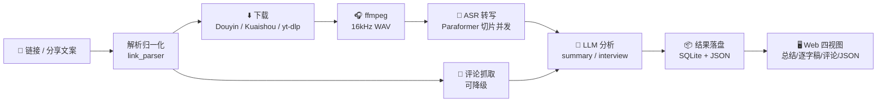

<div align="center">

# 🎬 VideoInsight Agent

**粘贴一条视频链接，拿回逐字稿、AI 总结、观众评论，以及一个可以追问的 AI 助手。**

[](https://www.python.org/)
[](https://fastapi.tiangolo.com/)
[](./tests)
[](https://dashscope.aliyuncs.com/)

</div>

---

## ✨ 能力一览

| | 能力 | 说明 |
|:--:|---|---|
| 🔗 | **链接即分析** | 支持抖音 / B站 / 小红书 / 快手，短链、分享文案直接往里贴，自动裁剪出干净链接 |
| 📄 | **逐字稿** | DashScope Paraformer 转写，带时间戳；长音频自动切片并发处理 |
| 🧠 | **AI 总结** | 结构化摘要；另有 `interview` 模式专门做面经/知识点提取 |
| 💬 | **观众评论** | 抖音走内置直连接口，零依赖抓取，并把评论一并喂给 LLM |
| 🤖 | **AI 追问** | 针对已完成的任务继续提问，模型只依据该视频的转写稿作答 |
| 📤 | **本地上传** | 拖进音频/视频文件即可分析，绕开一切平台风控 |
| 🗂️ | **历史与隔离** | 任务持久化在 SQLite，按浏览器身份隔离，重启不丢、互不串号 |
| 🎨 | **沉浸式前端** | 结果四视图、媒体在线播放与下载、深浅色主题切换 |

---

## 🚀 快速开始

```powershell
python -m venv .venv
.\.venv\Scripts\Activate.ps1
pip install -r requirements.txt
copy .env.example .env
uvicorn app.main:app --reload --host 127.0.0.1 --port 8000
```

| 入口 | 地址 |
|---|---|
| 🖥️ Web 界面 | <http://127.0.0.1:8000/> |
| 📚 API 文档 | <http://127.0.0.1:8000/docs> |
| 💚 健康检查 | <http://127.0.0.1:8000/health> |

> **开箱即用**：默认 `VIDEOINSIGHT_MOCK_MODE=true`，不装 ffmpeg、不配 ASR/LLM 密钥也能先把接口和整条工作流跑通。

---

## 🧠 三种分析模式

| 模式 | 产出 | 适合 |
|---|---|---|
| `transcript` | 带时间戳的纯逐字稿 | 只要文字，不调 LLM |
| `summary` | 结构化 AI 总结 | 快速掌握视频讲了什么 |
| `interview` | 面经 / 知识点提取 | 技术分享、经验复盘类内容 |

```powershell
curl -X POST http://127.0.0.1:8000/analyze `
  -H "Content-Type: application/json" `
  -d "{\"url\":\"https://example.com/video\",\"mode\":\"summary\",\"use_mock\":true}"
```

命令行同样可用：

```powershell
python cli.py "https://example.com/video" --mode summary
python cli.py "https://example.com/video" --mode interview
```

---

## 🔗 平台支持

| 平台 | 实现方式 | 是否需要 Cookies |
|---|---|---|
| 🎵 抖音 | 内置 `DouyinShareDownloader`（移动分享页 SSR + 无水印直链） | 需要 `ttwid`（见下方说明） |
| ⚡ 快手 | 内置 `KuaishouDownloader`（移动端分享页解析） | 否 |
| 📺 B站 | yt-dlp | 否 |
| 📕 小红书 | yt-dlp | 否 |
| 🌐 其他 | yt-dlp 通用提取 | 视平台而定 |

> **为什么抖音不用 yt-dlp 了？**
> yt-dlp 的抖音提取器走 `www.douyin.com/aweme/v1/web/aweme/detail/`，该接口已强制 `a_bogus` 签名校验
> （yt-dlp 至 2026.08.19 仍未实现，源码仅留 TODO），**即使 Cookies 齐全也一律 403**，
> 报 `Fresh cookies are needed` —— 反复重新登录是无效的。
> 本项目改走 `m.douyin.com` 移动分享页：SSR 数据里直接内嵌视频地址，再拼无水印直链下载。

---

## 💬 观众评论

抖音评论通过内置直连接口抓取，**不需要部署任何爬虫、不需要浏览器、不需要登录态**。

```text
抖音内置接口（iesdouyin v2）  →  失败时才降级  →  MediaCrawler（需另行部署）
```

⚠️ **已知限制**

- 接口固定返回**约 10 条热门评论**，`count` / `cursor` 参数均无效，无法翻页。
- 只有**一级评论**；楼中楼回复接口在 v2 下已下线。
- 仅抖音内置。B站 / 快手等平台需自行部署 [MediaCrawler](https://github.com/NanmiCoder/MediaCrawler)，
  并配置 `MEDIA_CRAWLER_OUTPUT_DIR` 或 `MEDIA_CRAWLER_API_URL`。

评论抓取失败只会静默降级，**绝不阻断**主分析链路。

---

## 🤖 AI 追问

任务完成后可以继续提问，模型只依据该任务的转写稿作答：

```powershell
curl -X POST http://127.0.0.1:8000/tasks/<task_id>/chat `
  -H "Content-Type: application/json" `
  -d "{\"question\":\"这段里提到的三个步骤分别是什么？\"}"
```

对话支持用户自备模型配置（请求体里带 `llm_provider` / `llm_api_key` 等），不填则用服务端配置。

---

## 📡 API 一览

| 方法 | 路径 | 用途 |
|---|---|---|
| `POST` | `/analyze` | 提交链接分析 |
| `POST` | `/analyze-file` | 上传本地文件分析 |
| `POST` | `/parse-link` | 从分享文案解析干净链接与标签 |
| `GET` | `/tasks` | 历史任务列表（按客户端身份隔离） |
| `GET` | `/tasks/{id}` | 查询任务与结果 |
| `DELETE` | `/tasks/{id}` | 删除任务并清理产物 |
| `POST` | `/tasks/{id}/chat` | 基于转写稿追问 |
| `GET` | `/tasks/{id}/media` | 在线预览媒体（支持 Range） |
| `GET` | `/tasks/{id}/video` | 下载源视频（mp4） |
| `POST` | `/cookies` | 上传 `cookies.txt` |
| `GET` | `/cookies/status` | 查看 Cookies 状态 |
| `POST` | `/cookies/qr/start` | 扫码登录 |
| `POST` | `/cookies/browser/*` | 专用浏览器窗口抓取登录态 |

<details>
<summary><b>历史记录与删除</b></summary>

任务与结果持久化在 SQLite（默认 `data/videoinsight.db`，可用 `VIDEOINSIGHT_DB_PATH` 修改）。

```powershell
curl "http://127.0.0.1:8000/tasks?limit=50"
curl "http://127.0.0.1:8000/tasks?status=succeeded"
curl -X DELETE http://127.0.0.1:8000/tasks/<task_id>
```

历史列表按浏览器生成的 `client_id` 隔离（请求头 `X-Client-Id`），看不到别人的任务。

</details>

<details>
<summary><b>上传文件分析</b></summary>

不依赖任何平台风控，是当前最稳定的主链路。

```powershell
curl -X POST http://127.0.0.1:8000/analyze-file `
  -F "file=@C:\path\to\your-video.mp4" `
  -F "mode=summary" `
  -F "use_mock=false"
```

文件暂存于 `media/<task_id>/`。

</details>

<details>
<summary><b>媒体预览与下载</b></summary>

```powershell
# 浏览器内联预览
curl http://127.0.0.1:8000/tasks/<task_id>/media

# 下载转写用音频
curl -o output.mp3 "http://127.0.0.1:8000/tasks/<task_id>/media?download=1"

# 下载源视频（完整画面，按需下载并缓存为 mp4）
curl -o output.mp4 "http://127.0.0.1:8000/tasks/<task_id>/video?download=1"
```

</details>

---

## ⚙️ 切换真实链路

1. 安装系统 `ffmpeg` 并加入 PATH（没装则回退到 `imageio-ffmpeg` 内置二进制）。
2. 安装 ASR 依赖：`pip install -r requirements-asr.txt`
3. 修改 `.env`：

```env
VIDEOINSIGHT_MOCK_MODE=false
DASHSCOPE_API_KEY=你的 DashScope Key
LLM_PROVIDER=deepseek
DEEPSEEK_API_KEY=你的 DeepSeek Key
LLM_BASE_URL=https://api.deepseek.com/v1
LLM_MODEL=deepseek-chat
```

真实链路：下载 → `ffmpeg` 转 16kHz 单声道 WAV → DashScope Paraformer 转写
（默认超过 **900 秒**切成 **600 秒**片段，最多 **3** 路并行）→ OpenAI-compatible LLM 调用。

<details>
<summary><b>常用环境变量</b></summary>

| 变量 | 默认 | 说明 |
|---|---|---|
| `VIDEOINSIGHT_MOCK_MODE` | `true` | Mock 开关，关闭后走真实下载/ASR/LLM |
| `VIDEOINSIGHT_TMP_DIR` | `data/tmp` | 临时目录 |
| `VIDEOINSIGHT_RESULTS_DIR` | `data/results` | 结果落盘目录 |
| `VIDEOINSIGHT_MEDIA_DIR` | `media` | 媒体与 Cookies 目录 |
| `VIDEOINSIGHT_DB_PATH` | `data/videoinsight.db` | SQLite 路径 |
| `DASHSCOPE_ASR_CHUNK_THRESHOLD_SECONDS` | `900` | 超过该时长开始切片 |
| `DASHSCOPE_ASR_CHUNK_SECONDS` | `600` | 每片时长 |
| `DASHSCOPE_ASR_MAX_WORKERS` | `3` | 并发转写路数 |
| `YTDLP_COOKIES_FROM_BROWSER` | — | 复用本机浏览器 Cookies，如 `chrome` / `edge` |
| `YTDLP_COOKIES_FILE` | — | Netscape 格式 `cookies.txt` 路径 |
| `MEDIA_CRAWLER_OUTPUT_DIR` | — | MediaCrawler 评论落盘目录 |
| `MEDIA_CRAWLER_API_URL` | — | MediaCrawler API 地址 |

</details>

---

## 🍪 抖音 Cookies

抖音只要求 Cookie 里有 **`ttwid`** 一项（用于读取移动分享页），**不需要登录态**。三种获取方式，任选其一：

**方式一：扫码登录（推荐）**

网页左侧「平台 Cookies」→ 扫码登录。抓到的 Cookies 保存在 `media/_cookies/cookies.txt`，无需重启服务。

**方式二：专用浏览器窗口**

1. 点「打开登录窗口」，在项目专用窗口中登录抖音
2. 回网页点「检查窗口」，确认 DevTools 已连接且找到抖音页面
3. 点「抓取登录态」

> 只读取项目专用窗口的 Cookies，不碰你日常浏览器的配置。

**方式三：手动上传 `cookies.txt`**

用浏览器扩展导出 Netscape 格式文件，在网页左侧上传，或配置 `YTDLP_COOKIES_FILE`。

> ⚠️ 如果提示「抖音拒绝了当前请求」，那不是 Cookies 过期 —— 而是触发了抖音临时风控。
> 稍后重试，或改用上传本地视频。

---

## 🧩 处理流程



> 评论抓取刻意排在下载之前：它只是一次轻量 HTTP 请求，不该被十几分钟的下载与转写拖着。

---

## 📁 项目结构

```text
app/
  main.py                  FastAPI 入口（任务、Cookies、媒体、对话）
  workflow.py              固定工作流编排
  task_store.py            SQLite 持久化任务存储
  schemas.py               请求、任务和结果模型
  config.py                环境配置
  prompts.py               LLM Prompt 模板
  link_parser.py           分享文案 → 干净链接 + 标签
  browser_cookies.py       专用浏览器抓取登录态（DevTools 协议）
  qr_login.py              扫码登录抓取 cookies
  cookies.py               平台 cookies 归一化与摘要
  errors.py                统一错误类型
  adapters/
    downloader.py          Mock / 抖音 / 快手 / yt-dlp 下载器（select_downloader 路由）
    audio.py               ffmpeg 音频预处理
    asr.py                 Mock / Paraformer 转写（长音频切片并发）
    llm.py                 Mock / OpenAI-compatible LLM
    comment_fetcher.py     观众评论（抖音直连 + MediaCrawler 对接）
web/
  index.html / app.js / styles.css   前端页面
tests/                               测试用例（131 passed）
verify_real_chain.py                 真实链路验证脚本
verify_kuaishou_video.py             快手全流程调试脚本
verify_comments_chain.py             评论链路验证脚本（mock 转写 + 真实评论接口）
docs/                                集成评估、评论数据产出、参赛材料
```

---

## 🧪 测试

```powershell
pip install pytest
pytest --basetemp=_pytest_tmp -q
```

当前 **131 passed / 0 failed**，覆盖下载器路由、评论解析、ASR 切片容错、任务隔离、链接解析与 LLM 适配。

---

## 🗺️ 边界与后续

**已完成**：API 提交/查询/列表/删除、文件上传分析、抖音免签名下载、观众评论抓取、AI 追问、
Mock 全链路闭环、可替换的下载/ASR/LLM 模块、SQLite 持久化、沉浸式 Web 前端。

**暂不包含**：Celery + Redis 异步队列、飞书机器人、PostgreSQL、内容安全与事实核查、多模态画面分析。

---

<div align="center">

用得顺手的话，欢迎点个 ⭐

</div>
